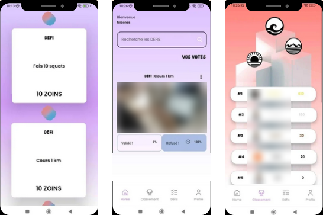
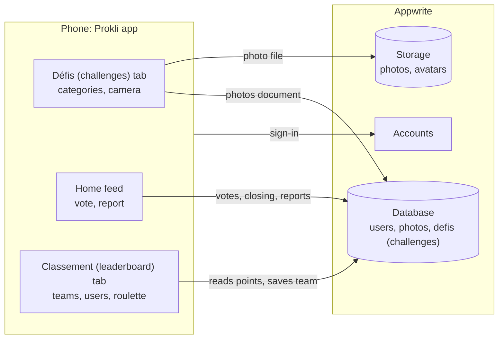

# Prokli

A phone app of holiday challenges, built with React Native, Expo and Appwrite. You pick a challenge,
post a photo as proof, the other players vote, and accepted photos earn points, which also count for your team.

The 2024 version (fonts and icons changed since; the feed photo and the usernames are blurred).

I wrote all of its code in summer 2024, during a two-month student startup project in a team of three.
The app has no server code of its own: it talks to Appwrite directly (accounts, database, file storage),
and it closes the votes and counts the points itself.

## How a challenge goes

1. In the Défis (challenges) tab, the player picks a category, then a challenge from the `defis` (challenges) collection
   they haven't posted a photo for yet.
2. The camera opens. The photo goes to storage, plus a `photos` document with `done: false`.
   A long press records a video instead; it is saved to the phone's gallery, not posted.
3. The other players see the photo in their home feed and vote "Validé" (accepted) or "Refusé" (refused),
   or report it with its "..." button.
4. Once the photo is 60 seconds old, the next refresh of any home feed closes its vote. With at least as many
   "Validé" as "Refusé", the photo stays (`done: true`) and the author gets the challenge's points; otherwise its
   document is deleted. A photo nobody voted on passes (0 against 0).
5. The first visit to the Classement (leaderboard) tab spins a roulette that puts the player in a team:
   montagne (mountain), ocean or soleil (sun). A team's score is the sum of its players' points.

The 10th report deletes a photo. The details, and the weak points of closing votes on the phones,
are in [The Appwrite backend](docs/01-appwrite-backend.md).

## Steps

1. [The Appwrite backend](docs/01-appwrite-backend.md)
2. [Run and build](docs/02-run-and-build.md)

## Repository layout

| Folder | Content |
|---|---|
| `app/` | the screens; Expo Router makes each file a route (`category/[name].tsx` is `/category/sport`...) |
| `components/` | cards, camera, vote buttons, form fields, photo card with its report button |
| `lib/` | `appwrite.js`, every call to the backend; `useQuery.js`, the data loading hook |
| `context/` | `SessionProvider.js`, the signed-in player, shared by every screen |
| `constants/` | the category and partner lists, the teams, picture imports |
| `assets/` | app icon, splash screen, pictures |
| `docs/` | the write-ups |

## Credits

The first version started from Adrian Hajdin's [aora](https://github.com/adrianhajdin/aora) React Native tutorial.
The code in this repository has been rewritten since.

## License

MIT, see [LICENSE](LICENSE).
