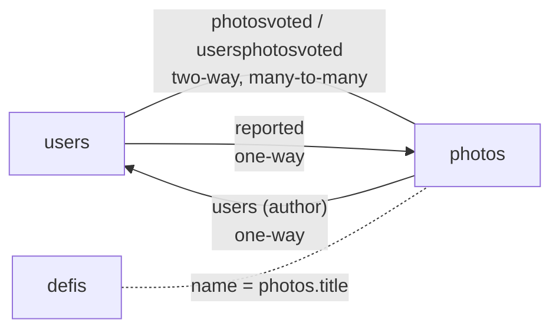

# The Appwrite backend

The app needs an Appwrite project (Cloud, or self-hosted 1.3 or later for relationships) with one database
of three collections, one storage bucket, and the app registered as a platform. Everything is created by hand
in the Appwrite console, challenges included: the app never creates collections or `defis` documents.

Write down each ID while creating things: they go into `.env` ([Run and build](02-run-and-build.md)).

## Collections

`users`, one document per player, created at sign-up:

| Attribute | Type | Use |
|---|---|---|
| `username` | string, required | shown on the profile and leaderboard |
| `email` | email, required | |
| `avatar` | url, required | an initials picture at sign-up, then the photo picked on the profile |
| `accountId` | string, required | `$id` of the Appwrite account, to find the document after sign-in |
| `points` | integer, default 0 | |
| `team` | string | `montagne`, `ocean` or `soleil`; empty until the player's first visit to the leaderboard, where a roulette picks one |
| `photosvoted` | relationship with `photos`, two-way, many-to-many | photos this player voted on; creating it also creates `photos.usersphotosvoted` |
| `reported` | relationship with `photos`, one-way, many-to-many | photos this player reported, hidden from their feed |

`photos`, one document per posted photo. The app sets every attribute when it posts, except `reports`:

| Attribute | Type | Use |
|---|---|---|
| `title` | string | the challenge's `name`; needs a full-text index, the search bar queries it |
| `photo` | url | view URL of the file in storage |
| `users` | relationship with `users`, one-way, many-to-one | the author |
| `points` | integer | copied from the challenge |
| `valide`, `refuse` | integer | vote counts, 0 at posting |
| `done` | boolean | `false` at posting, `true` once the vote accepted it |
| `reports` | integer, default 0 | |

The app deletes photos (refused, or reported 10 times). Set "on delete" to **Set NULL** on the three
relationships: with Restrict, a photo someone voted on can't be deleted; with Cascade on `photos.users`,
deleting a photo would delete its author.

`defis`, the challenges, added by hand:

| Attribute | Type | Use |
|---|---|---|
| `name` | string, required | the challenge text, shown on the card; keep names unique, a photo is matched to its challenge by name |
| `points` | integer, required | |
| `categorie` | string, required | `sport`, `bouffe`, `adrenaline`, `musee` or `parc-test` |

A category value is also the end of its screen's route: `/category/sport` lists the `defis` with
`categorie = sport` whose `name` the player hasn't posted yet. `musee` and `parc-test` are the challenges of
two partner places, listed under "NOS PARTENAIRES" in the app (placeholder names). The categories and partners
shown are in `constants/categories.js`.

## Storage

One bucket for posted photos and avatars. The app uploads JPEG, PNG and HEIC files and stores the file's view URL
in `photos.photo` or `users.avatar`. It never deletes files: a deleted photo leaves its file in the bucket.

## Platform

Appwrite only answers apps registered in the project. Add an Android platform with the package name
`com.prokli.app`, and an iOS one with the same bundle ID. That value is hard-coded in `app.json` and
`lib/appwrite.js`; change both together.

## Permissions

What the code needs, for signed-in users (role `users`), as collection-level permissions:

| Resource | Needs | Why |
|---|---|---|
| `users` | create, read, update | sign-up signs in first, then creates the document; closing a vote adds points to someone else's document |
| `photos` | create, read, update, delete | voting and reporting change other players' photos; a refused photo is deleted |
| `defis` | read | |
| bucket | create, read | |

If photos don't show, give the bucket read for `any`: the image views load the file URL without the Appwrite session.

This is the weak point of the design. Since the phones close votes and write points, any signed-in client can
write any score, and two phones refreshing at the same moment can both settle the same photo. The fix would be
an Appwrite Function that settles votes on the server, with each player allowed to update only their own
`users` document.

## Votes and reports

`closeExpiredVotes()` in `lib/appwrite.js` runs each time a player pulls down to refresh the home feed.
It settles every photo with `done: false` whose `$createdAt` is more than `VOTE_WINDOW_SECONDS` (60) ago:
at least as many `valide` as `refuse` (a photo with no votes included) gives the photo's points to its author
and sets `done: true`; otherwise the photo is deleted. With nobody refreshing, votes stay open.

Reports apply at once: `reportPost()` counts the report and, at the 10th (`MAX_REPORTS`), deletes the photo.

Previous: [Overview](../README.md) · [All steps](../README.md#steps) · Next: [Run and build](02-run-and-build.md)
